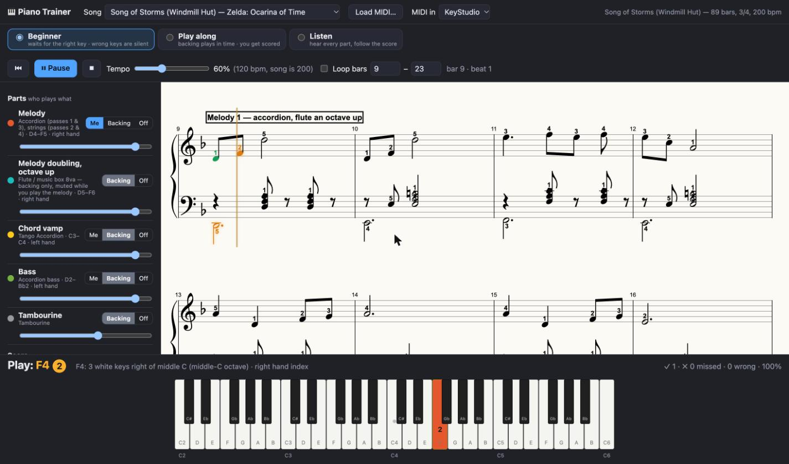

# Piano Trainer

A browser piano trainer for a USB MIDI keyboard. It shows live sheet music with fingering on a
grand staff, lights up the keys to press, plays the other parts of the song as backing, and has a
beginner mode that waits for the right key and keeps wrong keys silent.

It ships with **Song of Storms** (the *Windmill Hut* theme from *The Legend of Zelda: Ocarina of
Time*, by Koji Kondo) arranged with every part of the original track playable.



## Features

- **Beginner mode** – the backing plays until your next note, then stops and waits. The key lights
  up with its finger number and the panel tells you the note name and where it is ("F4: 3 white keys
  right of middle C · right hand index"). Wrong keys stay silent and flash red. Chords only pass when
  every note is down at the same moment, and notes of a quarter or longer must be held for their
  written length: let go early and the music stops until you press the note again.
- **Play along** – the backing keeps time and you are scored: green notes hit, red notes missed.
- **Listen** – hear every part and follow the cursor.
- **Grand staff** – right-hand parts on the treble staff, left-hand parts on the bass staff as
  separate voices, with fingering numbers, beams, ties, bar numbers and section labels.
- **Parts panel** – each part is *Me* (you play it, the backing leaves it out), *Backing* or *Off*,
  with its own volume. Practice the melody, the chords, the bass, or several at once.
- **Loop and tempo** – drill any range of bars at any speed. Click a bar in the score to jump there.
- **Load any MIDI file** – every track becomes a part with automatic fingering and a guessed key.
- **Sampled instruments** – accordion, strings, flute, music box, bass and more from the
  [MIDI.js soundfonts](https://github.com/gleitz/midi-js-soundfonts), with a synth fallback offline.
- **No build step** – plain HTML, CSS and ES modules. VexFlow renders the notation.

## Quick start

Requirements: [Node.js](https://nodejs.org) 18 or newer and Chrome (or Edge/Opera, which also
support Web MIDI). No npm packages to install.

```bash
git clone https://github.com/williammunnich/keyboardng.git
cd keyboardng
npm start            # serves http://127.0.0.1:8765/
```

Open the address in Chrome, click **Start**, and click **Allow** when Chrome asks for MIDI access.
The first MIDI keyboard found is selected (an M-Audio KeyStudio is preferred if present).

No MIDI keyboard? The computer keyboard works: <kbd>A S D F G H J K</kbd> are white keys from C,
<kbd>W E T Y U</kbd> black keys, <kbd>Z</kbd>/<kbd>X</kbd> shift octaves. The on-screen keys are
clickable too.

### Keyboard shortcuts

| Key | Action |
|---|---|
| Space | Play / pause |
| Home | Back to start (or loop start) |
| ← / → | Previous / next bar |
| Esc | Stop |

## Song of Storms

The arrangement follows the original soundtrack recording
([this video](https://www.youtube.com/watch?v=UtgHZaq0EGs)): 3/4, D minor, 200 bpm, 89 bars.

| Part | In the original | Range | Hand |
|---|---|---|---|
| Melody | Accordion (passes 1 and 3), strings (passes 2 and 4) | D4–F5 | Right |
| Melody doubling | Flute, then music box, an octave up (backing only) | D5–F6 | – |
| Chord vamp | Tango accordion, eighth-note Dm / Em / F / Em stabs | C3–C4 | Left |
| Bass | One note per bar | D2–B♭2 | Left |
| Tambourine | Percussion | – | – |

Form: 8-bar intro vamp, then the 15-bar melody four times with 7-bar vamps in between. The two
left-hand parts sit an octave below the accordion transcription so they read in the bass clef, as a
piano reduction would. The doubling is muted automatically while you play the melody; if you want to
play it, use your keyboard's octave button and tick "Accept the right note in any octave".

Melody fingering is a suggested 1-2-5 hand position, not from a published edition.

## Adding songs

**Any MIDI file** can be opened with **Load MIDI…**. Tracks become parts; drum channels become
backing-only percussion; the key is read from the file or guessed.

**Built-in songs** are JSON files in `songs/` (see `songs/song-of-storms.json`) with this shape:

```jsonc
{
  "title": "…", "bpm": 200, "timeSig": { "num": 3, "den": 4 },
  "key": { "fifths": -1, "mode": "minor" },
  "sections": [{ "bar": 8, "label": "Melody 1" }],
  "parts": [{
    "id": "melody", "name": "Melody", "instrument": "accordion",   // soundfont name
    "clef": "treble", "hand": "R", "color": "#e4572e", "playable": true,
    "notes": [{ "t": 24, "d": 0.5, "p": 62, "v": 90, "f": 1 }]      // beat, length, MIDI pitch, velocity, finger
  }]
}
```

Notes may carry `"instr"` to override the part's instrument. A part with `"doubles": "melody"` is
muted while that part is set to *Me*. Register the file in the `SONGS` list in `js/app.js`.

The bundled arrangement is generated from a community MIDI transcription on
[vgmusic.com](https://www.vgmusic.com) that is not included in the repository:

```bash
npm run fetch-reference   # downloads it into songs/reference/
npm run build-song        # rebuilds songs/song-of-storms.json (fingering lives in tools/build-song.mjs)
```

With the reference file present, the app also lists it as a song so you can hear all seven
original tracks.

## Debugging

Open `http://127.0.0.1:8765/?debug=1` or tick **Debug log** in the sidebar. A draggable, minimizable
panel (also mirrored to the console as `[trainer]`) logs raw MIDI bytes, every note decision (hit,
early, wrong), waits and advances in beginner mode, scheduler batches, soundfont loads and errors.
`window.__trainer` exposes the state, transport and `userNoteOn(pitch, velocity)` for scripting.

## Project layout

| Path | What |
|---|---|
| `index.html`, `css/app.css` | UI |
| `js/app.js` | Controller: transport, scheduler, modes, scoring, settings |
| `js/score.js` | VexFlow grand-staff rendering, cursor, highlighting |
| `js/songmodel.js` | Quantizing, measures and ties, key spelling, fingering heuristics, MIDI → song |
| `js/synth.js` | Web Audio engine: soundfont samples, synth fallback, tambourine |
| `js/midi-in.js` | Web MIDI input and computer-keyboard fallback |
| `js/keyboard.js` | On-screen keyboard |
| `serve.mjs` | Dependency-free static server with caching disabled |
| `tools/` | Song build and reference download scripts |

## Credits and license

Code is MIT licensed (see `LICENSE`). *Song of Storms* is © Nintendo, composed by Koji Kondo; the
arrangement here is a transcription for personal practice. Notation by [VexFlow](https://www.vexflow.com),
MIDI parsing by [@tonejs/midi](https://github.com/Tonejs/Midi), instrument samples from
[midi-js-soundfonts](https://github.com/gleitz/midi-js-soundfonts) (MusyngKite).
